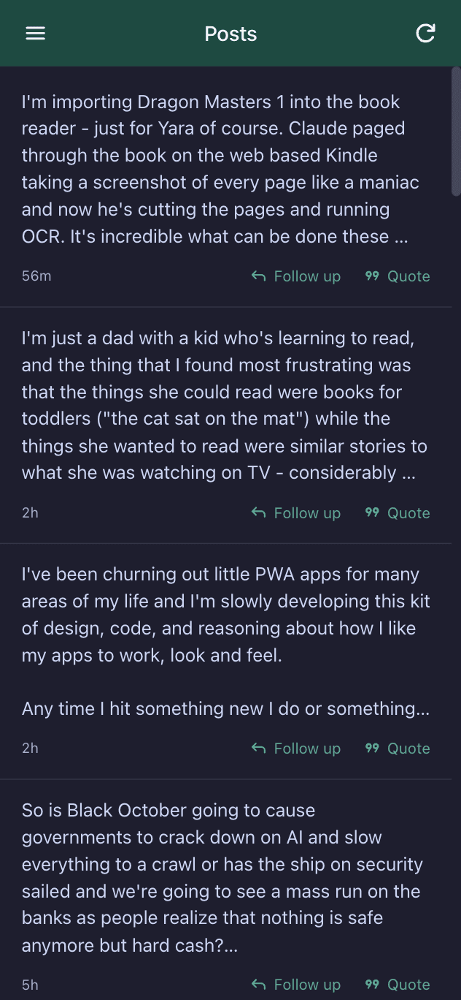
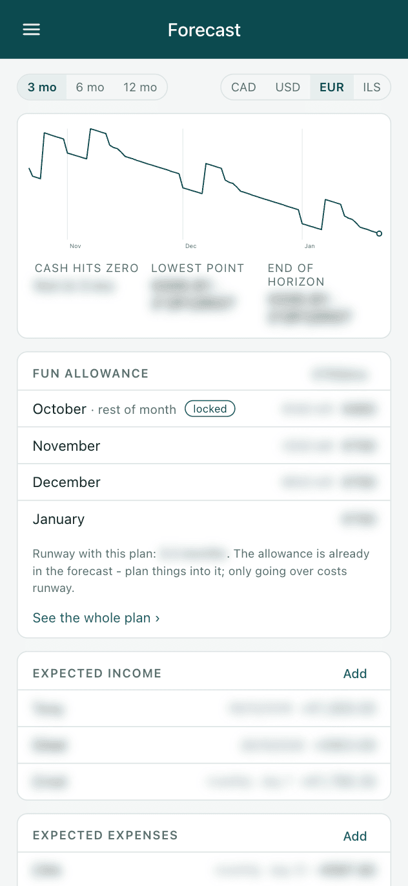
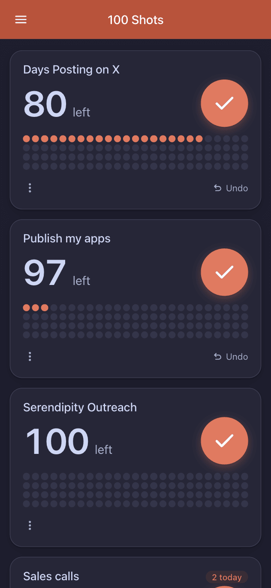
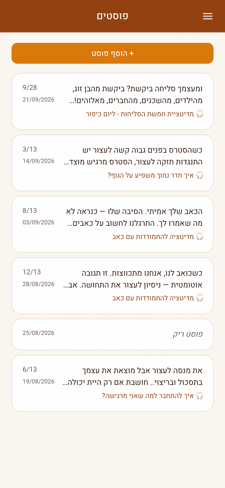

# pwa-kit

A Claude Code skill for building mobile web apps that feel native: installable, fast to open, and free of the small wrongnesses that give a web app away. It's what I use to build all my apps, and it's how they stay consistent with each other without sharing a line of code at runtime.

<table>
  <tr>
    <td></td>
    <td></td>
    <td></td>
    <td></td>
  </tr>
  <tr>
    <td align="center">notime</td>
    <td align="center">Accountant</td>
    <td align="center">100 Shots</td>
    <td align="center">Meditation admin (RTL)</td>
  </tr>
</table>

Four apps built on the kit. They look different on purpose. What they share is how they behave.

The unusual thing about it is what gets reused. It isn't mainly a component library. The reusable part is a spec, a set of documents that say how an app shell should behave, what an update should feel like, when a setting saves, what the Enter key does on a phone. Code is there only where prose isn't precise enough. A service worker update flow, an autosave race, the iOS keyboard pushing the page around - these took several tries to get right, so the kit keeps the version that works, with comments at the places where the obvious approach failed.

That changes how the code gets reused. A library is made generic so you never have to edit it, because editing used to be expensive. Now an agent edits code almost for free, and what's expensive is getting it right. So kit files are copied into each app and adapted there. Each copy carries a header like `pwa-kit: shell/ui/Drawer.svelte v11`, and a small script compares an app's copies with the kit. That tells you, for any file, whether the kit has moved on, whether the app changed it, or both.

Apps don't all have to keep up. An app takes the latest kit when someone is working on it anyway, and a change an app makes can be promoted back into the kit with the reasons attached. Most of the kit started that way, as a fix in one app.

## What's in it

- **`reference/`** is the spec: shell and layout, visual style, behavior (sign-in, settings, autosave, keyboards, navigation), service worker updates, chat and realtime, media, push, Cloudflare deployment, a ship checklist, and notes on Hebrew/RTL.
- **`kit/`** is about twenty-five items of copyable code: the update flow, Google sign-in with 90-day sessions, an app shell with a drawer and safe areas, settings pages, theming with an accent color and a matching app icon, a WebSocket client with a reconnection state machine, web push on Workers, autosave, drag-to-reorder, and more. Each item has a README saying what decisions it embodies, which parts an app is expected to change, and how to check it works.
- **`scripts/kit.py`** tracks drift between the kit and an app. `scripts/typecheck/` builds the whole kit as one project, so a kit edit can't quietly break it.

The stack is Svelte 5, Vite and TypeScript, deployed on Cloudflare (Pages and Functions, or a Worker with Durable Objects), with plain CSS custom properties and no UI framework. If you use something else, the reference docs still apply. Most of what they say is about behavior, not syntax.

## Install

```
git clone https://github.com/finereli/pwa-kit ~/.claude/skills/pwa
```

Then ask Claude Code to build a mobile app, or to "update this app to the latest pwa skill". The skill loads when it's relevant.

One caveat: the `login` item is a client for my own sign-in service, login.finereli.com, which only accepts my apps. Use the `auth` item instead. It does the same job with your own Google OAuth client.

## How it got here

The history goes back to August 2026, when the kit was extracted from a meditation app, its admin, and two companion chatbots. [CHANGELOG.md](CHANGELOG.md) is the more useful record. Every version of every item has a note saying why it exists, and those notes are usually a bug someone actually hit.

## License

MIT

---

## For agents

Everything below is for the model using this skill. [`SKILL.md`](SKILL.md) is the entry point and has the full procedures. This is the short version.

**Read on demand.** Each file in `reference/` is self-contained. The table in `SKILL.md` maps what you're working on to the file to read. Don't load them all.

**Building a new app:** read `reference/shell.md`, `behavior.md` and `updates.md`, plus the profile you need (chat, media, admin). Copy the kit items the app needs into `shared/{lib,ui,functions,css,build}/`, keep the `pwa-kit` headers exactly, and work the seams each item's README lists. Run each item's verify recipe before building on it. Domain code goes in the app, not in `shared/`.

**Updating an app:** `python3 ~/.claude/skills/pwa/scripts/kit.py status <project> --all`.

| Status | Meaning | Do |
|---|---|---|
| `current` | same as the kit | nothing |
| `upstream` | kit moved, app copy untouched | copy the new file over |
| `modified` | app edited it, kit didn't move | leave it; consider promoting |
| `both` | both moved | merge by hand, keeping both intents; read the item's notes in `kit/MANIFEST.json` |
| `unknown` | header the manifest doesn't know | investigate |
| `available` | kit item the app doesn't use | mention, don't add |

Never silently overwrite a `modified` or `both` file. Report per file what you did and why.

**Promoting a change into the kit:** edit the kit file, run `scripts/typecheck/run.sh`, then `python3 scripts/kit.py bump <item> --note "why this version exists"`. The note is the changelog entry (`bump` regenerates `CHANGELOG.md`), so write the reason, not the diff. `kit.py check` verifies every header and hash against the manifest.

**Pull, not push.** A kit change doesn't mean every app gets updated now. The exception is a fix for something users are hitting, like a stuck update or a data-loss race. That's worth a pass over every app that has the item.
